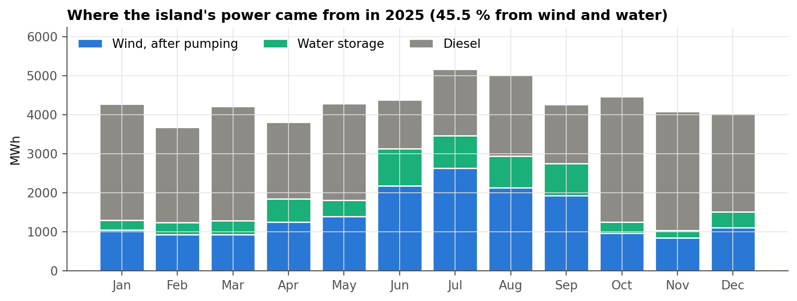
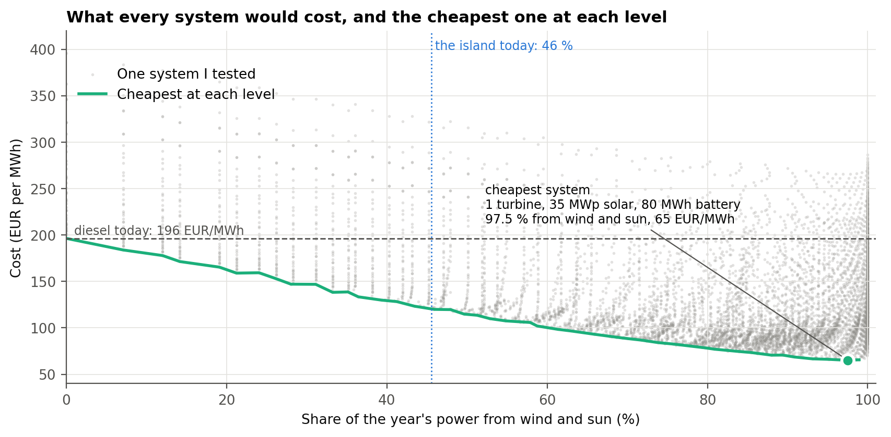
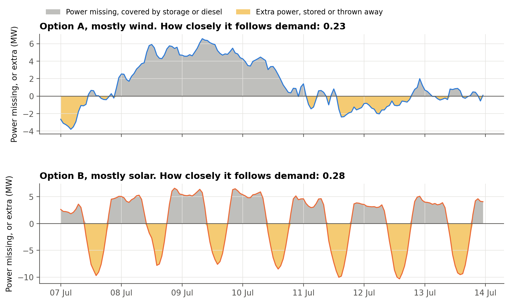
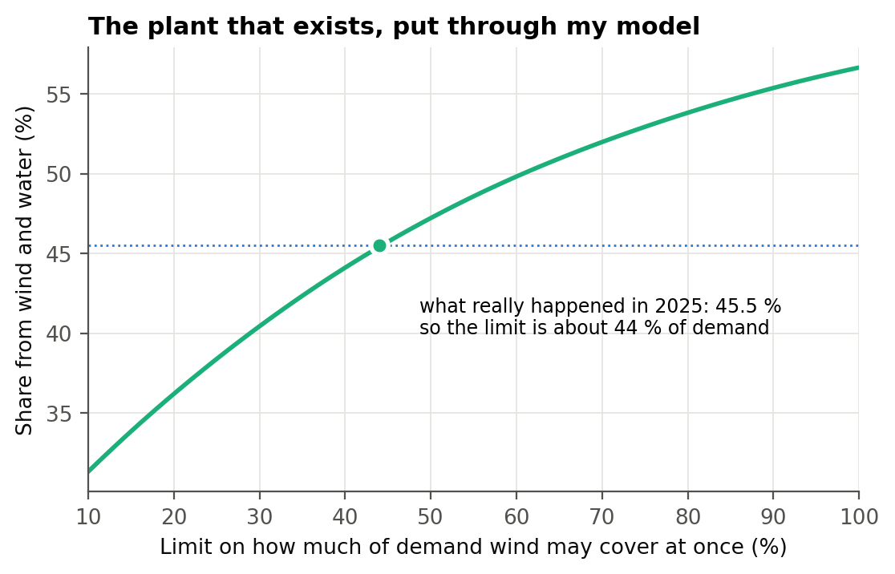
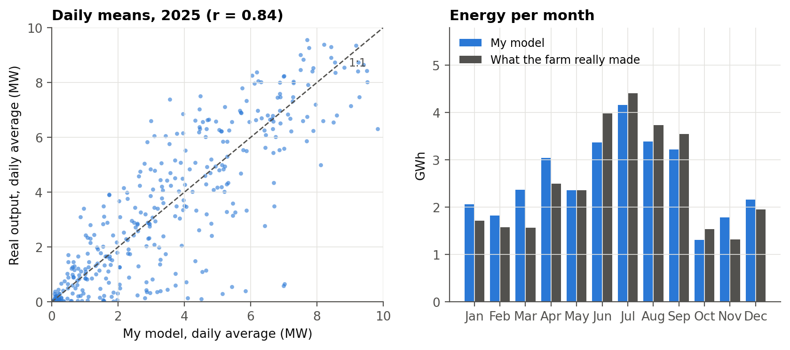
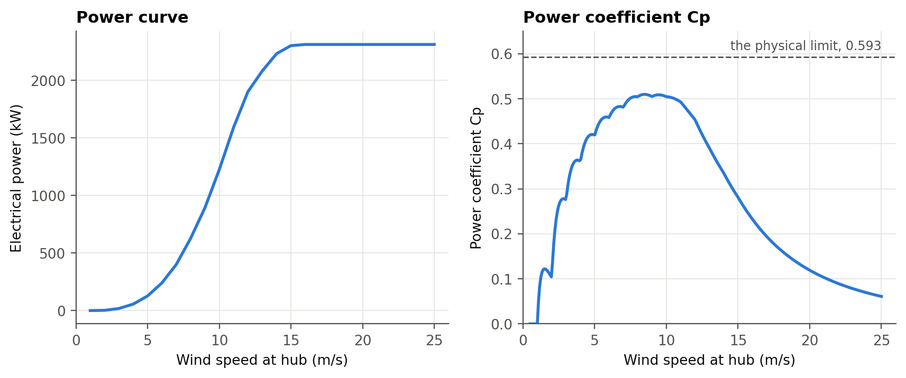
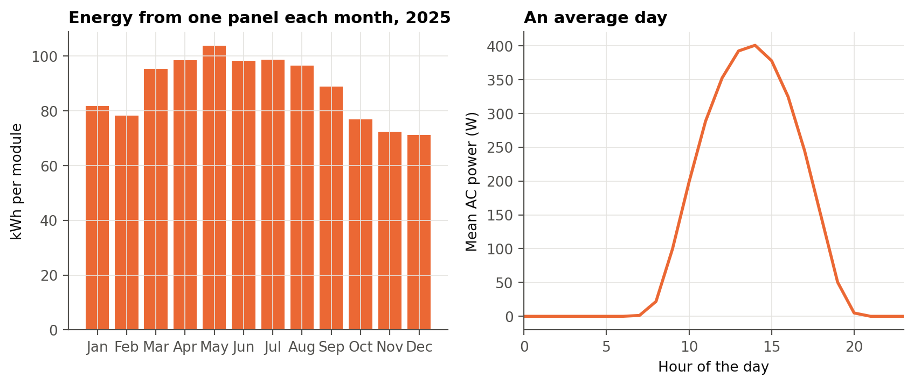
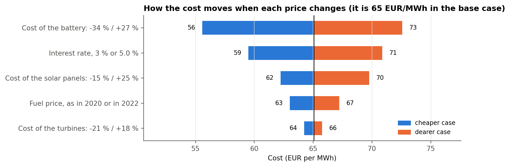

# Wind, Solar and Battery Sizing for El Hierro

Ioanna Texakalidou, independent energy systems study, 2026

## The short version

El Hierro is a small island in the Canary Islands with no power cable to the mainland. Whatever electricity it uses, it must make itself. Today about half comes from burning diesel.

I built a computer model of the island's electricity, hour by hour for a whole year, using real measured data. Then I asked: what mix of wind turbines, solar panels and batteries would supply the island most cheaply?

**My answer:** 1 wind turbine, 35 MW of solar panels and an 80 MWh battery would supply 97.5% of the island's electricity from wind and sun, for 65 EUR per MWh. Electricity from the diesel plant costs 196 EUR per MWh in fuel and maintenance alone, so this system would cost about a third as much. CO2 emissions would fall by 95%. The full equipment list, technical data and costs are in [TECHNICAL_DATA.md](TECHNICAL_DATA.md).

## Some background

El Hierro uses 51.6 GWh of electricity a year. At its busiest moment it needs 9.1 MW.

The island is known for its Gorona del Viento plant, which combines wind and water. When the wind blows hard, the turbines also power pumps that push water up a hill into a reservoir. When the wind drops, the water runs back down through water turbines and makes electricity again. The idea is that the island can run on wind even when there is no wind.

In 2025 this plant covered 45.5% of the island's electricity. The diesel plant made the rest. I wanted to understand why it stops there, and what a cheaper, cleaner system could look like.

Where the island's electricity came from in each month of 2025. Blue is wind power that went straight to the island. Green is power from the water stored in the reservoir. Grey is diesel. Wind is strong in summer, so diesel is lower then. In winter diesel still covers about 70% of demand.

## What I found

1. The island could run almost entirely on wind and sun, and it would be cheaper. The least-cost system I found gets 97.5% of the island's electricity from renewables at 65 EUR/MWh. Going all the way to 100% is possible too, at 73 EUR/MWh. That is still far below the cost of diesel, but it needs more solar panels and a larger battery, and 41% of the energy they make would go unused.

2. Solar plus a battery beats wind on its own. Solar power is very regular in the Canaries. It is strong every day, and a battery can easily move the midday surplus into the evening. Wind can disappear for several days at a time, and no affordable battery can bridge that gap. So the best system is mostly solar, with a battery and a small amount of wind. One wind turbine still pays off because the trade winds also blow at night.

3. The real plant is held back by grid stability, not by a lack of energy. When I fed the real Gorona plant into my model, I could only reproduce what really happened in 2025 when I limited wind to about 44% of demand at any moment. A small island grid becomes unstable if too much of its power comes from wind at once, so the operator keeps diesel engines or water turbines spinning as a safety margin. I also measured from the operator's data that the water storage returns only 48% of the energy used to pump the water up.

4. For the planned expansion, a battery that stabilises the grid matters more than extra turbines. Gorona has announced more wind and solar. My model says that under today's operating limit this brings the island to about 64% renewable. If they add even a small battery (10 MWh) that can stabilise the grid, the limit can be lifted and the share rises to about 83%.

5. The result holds when the prices change. I varied every cost within the range its own source publishes. The cost stayed between 56 and 73 EUR/MWh, always far below diesel. I also tested the design on a different year's weather (2024), and it still reached 95.7% renewable at 66 EUR/MWh.

## The system I recommend

| | |
|---|---|
| Wind | 1 Enercon E-70 turbine, 2.3 MW |
| Solar | 35 MW of panels (about 60,300 panels of 580 W), on about 27 hectares |
| Battery | lithium ion, 80 MWh of storage, 10 MW in or out (8 hours) |
| Diesel plant | the existing one stays as backup and covers the last 2.5% |
| Investment | 42.2 million EUR |
| Renewable share | 97.5% |
| Cost of electricity | 65 EUR/MWh (diesel alone: 196 EUR/MWh) |
| CO2 | from 21,300 to 1,000 tonnes per year |

The equipment data sheets, a bill of materials and the cost breakdown are in [TECHNICAL_DATA.md](TECHNICAL_DATA.md).

## The figures explained

### Every system I tested and what it would cost

Each grey dot is one possible system, a different number of wind turbines, solar panels and battery size. I tested 7,040 of them. The horizontal axis shows how much of the island's electricity that system gets from wind and sun. The vertical axis shows what each MWh would cost. The green line connects the cheapest system at each level.

How to read it: the green line goes down from left to right. So every step towards more renewables makes electricity cheaper, all the way to about 98%. Only beyond that does it start to rise again. The green dot marks the cheapest system of all. The dashed line is the cost of diesel today, and the blue dotted line is where the island is today (46%).

### Mostly wind or mostly solar?

The same summer week for two possible systems. The top one uses mostly wind turbines and the bottom one mostly solar panels. Grey means the renewables are not making enough and something else must fill the gap. Yellow means they make more than the island needs.

With wind (top), there is a three day gap from 8 to 10 July when the wind dropped. A battery would have to be enormous to cover that. With solar (bottom), there is a gap every night and a surplus every midday. A battery that fills up at noon and empties at night solves this, which is why solar plus a battery comes out cheaper. The number in each title (0.23 and 0.28) shows how well production follows the island's demand. Both are low, which is why storage is needed in either case.

### Why the real plant stops at 45%

This figure is about the existing Gorona plant (wind and water). I ran it through my model many times. Each time I allowed wind to cover a different maximum share of demand at any moment, shown on the horizontal axis. The vertical axis shows the share of the year's electricity the plant would then supply.

What really happened in 2025 (45.5%) matches a limit of about 44%. In other words, the plant behaves as if wind is never allowed to cover more than 44% of what the island needs at a given moment. With no limit at all, the same plant would reach about 57%. The bottleneck is keeping the grid stable, not a shortage of wind.

### Checking my wind model against the real wind farm

This is about wind only. Before trusting my model, I checked it against what the real Gorona wind farm produced in 2025.

On the left, each dot is one day: the horizontal position is what my model predicted, and the vertical position is what the real farm produced. If the model were perfect, all dots would sit on the dashed diagonal line. They follow it closely (correlation r = 0.84, where 1 would be perfect). On the right are the monthly totals of my model (blue) and the real farm (grey).

One correction was needed. The weather data I used comes in squares 25 km wide, too coarse to see the ridge where the turbines stand. At first my model therefore had 14% more wind than the site really has, so I scaled it down to match the site's published production. The real farm sometimes makes less than my model in winter because the operator turns turbines down when the island cannot absorb the power.

### The wind turbine: power curve and Cp

This is also about wind. It describes the turbine I used, the Enercon E-70, the same model that stands on El Hierro today.

The left graph is the power curve, the manufacturer's data on how much electricity the turbine makes at each wind speed. It starts at 2 m/s, rises steeply, and reaches its full 2.3 MW at about 15 m/s. Above that it holds steady until it shuts down for safety at 25 m/s.

The right graph shows Cp, the share of the wind's energy passing through the blades that the turbine turns into electricity. Physics sets a ceiling of 59.3% (the Betz limit, dashed line), because the air must keep moving past the turbine. The E-70 reaches about 50% at moderate winds of 8 to 10 m/s, which is close to that ceiling. At high winds the share falls on purpose, because the turbine is already at full power and lets the extra wind pass.

### One solar panel through the year

This is about solar. It shows what one 580 W panel would produce on El Hierro. On the left is the energy per month: about 104 kWh in May and about 71 kWh in December. Unlike in northern Europe, winter output is still about 70% of the best month, which makes solar very dependable here. On the right is the average power over a day, peaking in the early afternoon. Over the year one panel makes about 1,061 kWh. Dust from the Sahara costs about 6% of that and heat about 5%.

### What happens if prices change

Each bar shows how the cost of the recommended system moves when one price changes, using the low and high values that the price's own source publishes. The battery price and the interest rate matter most. The fuel price matters little, because at 97.5% renewable the island buys hardly any diesel. In every case the cost stays between 56 and 73 EUR/MWh, far below diesel's 196.

## How I did it

1. I rebuilt the island's electricity use hour by hour from the grid operator's public data (Red Eléctrica, readings every 5 minutes, about 210,000 for 2024 and 2025). I added weather data (ERA5) and data on dust in the air (CAMS).
2. I modelled the real Enercon E-70 turbine from its power curve, adjusting for the thinner air at the site's altitude and for time lost to maintenance.
3. I modelled a current 580 W solar panel, including losses from heat and dust, and checked its yield against the European Commission's PVGIS tool (within 4%).
4. I checked the wind model against the real wind farm, as explained above.
5. I simulated 7,040 combinations of turbines, panels and battery for every hour of the year. Equipment costs come from the Danish Energy Agency, the diesel price from the EU Weekly Oil Bulletin and the interest rate from the European Commission's benchmark for public projects.
6. I tested how the result moves when each price changes.

## Limitations

The 44% grid stability limit is something I inferred by matching my model to the real plant, not a published operating rule. Costs are European catalogue values, not quotes for the island. The model works in one hour steps, so it cannot show what happens on the grid within seconds, which is exactly where the stability limit comes from. Demand is kept at today's level. If the island moves to electric cars, it will grow.

## A few terms

| Term | Meaning |
|---|---|
| MW (megawatt) | power, how much electricity is being made or used at one moment |
| MWh (megawatt hour) | energy, 1 MW running for one hour (1 MWh = 1,000 kWh, the unit on a household bill) |
| MWp | the rated power of solar panels in full sunshine |
| Capacity factor | what a turbine or panel really produces in a year, compared with running at full power all year |
| Cost per MWh (LCOE) | all the costs of a system over its life, divided by the electricity it delivers |
| Renewable share | the part of the year's electricity that came from wind, sun or water instead of diesel |
| Curtailment | renewable power that is switched off because nobody needs it at that moment and the battery is full |
| Grid stability limit | the most wind and solar the grid accepts at one moment before it risks becoming unstable |

## Tools

Python (pandas, NumPy, Matplotlib), ERA5, PVGIS, REE grid data

The code and data are private. I'm happy to walk through the model on a call.

Contact: j.texakalidou@gmail.com | [Portfolio](https://ioannatexakalidou.github.io)
